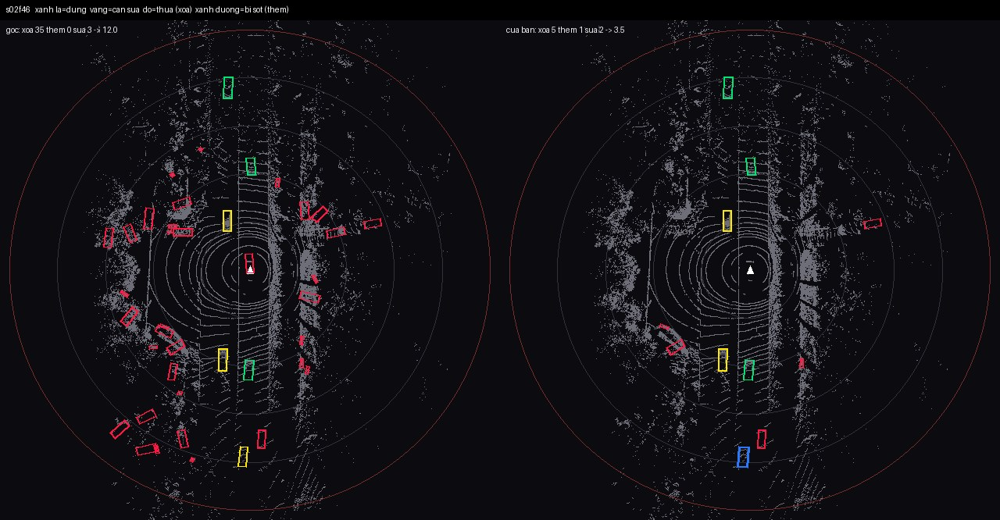

# Báo cáo Day 14 — Nguyễn Mạnh Dũng — 2A202603197

- Mã học viên dùng với `--student`: `197`
- `seed_tag` trong `frames_A.txt`: `393590736f`

## 1. Dự đoán trước sweep (bước 5b)

Ghi **trước** khi chạy `scripts/pp_sweep.py`, rồi commit và push ngay (lịch sử commit là bằng chứng thời điểm viết). Không sửa phần này sau khi có kết quả.

- Tham số tôi nghĩ giảm công sửa nhiều nhất: tăng `score_thr` từ 0.1 lên 0.4.
- Vì sao: Tôi dự đoán tăng `score_thr` từ 0.1 lên 0.4 sẽ giảm chi phí sửa. Ở cấu hình gốc, tập A có 60 box cần xóa, 2 box cần thêm và 14 box cần sửa, tổng chi phí là 27.0. Tôi kỳ vọng tăng ngưỡng tin cậy sẽ loại bớt box thừa và giảm thao tác xóa. Tuy nhiên, ngưỡng cao có thể loại cả box của vật thể thật, làm tăng số box phải thêm. Vì vậy, tôi dự đoán chi phí sẽ giảm nhưng cần kiểm chứng bằng sweep.

## 2. Tập A: sửa tay và tune

| Cấu hình | Xóa | Thêm | Sửa | Chi phí |
|---|---:|---:|---:|---:|
| Gốc | 60 | 2 | 14 | 27.0 |
| `best_config.json` | 8 | 7 | 10 | 14.4 |

- Tham số đã đổi trong `best_config.json`: `score_thr` từ 0.1 lên 0.5; `min_points` giữ ở 0.
- Kết quả leave-one-out:

```text
s01f51: cấu hình chọn {'score_thr': '0.5', 'min_points': '0'} → 5.8 (tốt nhất có thể 5.8)
s02f46: cấu hình chọn {'score_thr': '0.5', 'min_points': '0'} → 3.5 (tốt nhất có thể 3.5)
s04f09: cấu hình chọn {'score_thr': '0.5', 'min_points': '0'} → 5.1 (tốt nhất có thể 5.1)
```

- Tôi chọn `score_thr=0.5`, `min_points=0` vì cấu hình này có chi phí thấp nhất trên tập A (14.4) và cả 3 lượt leave-one-out đều chọn cùng cấu hình. Chi phí giảm trên cả 3 frame: s01f51 từ 8.3 xuống 5.8, s02f46 từ 12.0 xuống 3.5, s04f09 từ 6.7 xuống 5.1. Kết quả ổn định trong tập A, nhưng chỉ tune trên 3 frame nên tôi chưa thể khẳng định đây là cấu hình tốt nhất cho mọi cảnh.

## 3. Trước/sau (bước 8)



- `scripts/pp_compare.py` báo giảm 47% chi phí sửa trên tập A (27.0 → 14.4; tính chính xác là 46.7%).
- Dự đoán tăng `score_thr` lên 0.4 sẽ giảm chi phí sửa là đúng trên tập A: chi phí giảm từ 27.0 xuống 18.0 (33.3%), với 25 box cần xóa, 5 box cần thêm và 11 box cần sửa. Mức 0.5 còn giảm chi phí xuống 14.4, với số box cần xóa giảm từ 60 xuống 8 và số box cần sửa giảm từ 14 xuống 10. Tuy nhiên, số box cần thêm tăng từ 2 lên 7, thể hiện đánh đổi giữa giảm box thừa và tăng bỏ sót.

## 4. Tập B

Số đo từ `scripts/pp_prelabel.py --frames d14_197/frames_B.txt --config d14_197/best_config.json --gt d14_197/ref_B.json`:

| Xóa | Thêm | Sửa | Chi phí |
|---:|---:|---:|---:|
| 50 | 17 | 19 | 41.5 |

- Các lỗi tôi gặp khi sửa tập B: Bus và người đi bộ hay bị bỏ sót; box Car hay lệch vị trí và đáy box không chạm mặt đường; một số bụi cây bị nhận nhầm thành Cyclist hoặc Car.

## 5. Giới hạn

- Khả năng phát hiện và phân lớp còn hạn chế: tôi gặp Bus và người đi bộ bị bỏ sót, bụi cây bị nhận nhầm thành Cyclist hoặc Car.
- Hình học cuboid còn sai: box Car có thể lệch vị trí và không chạm mặt đường, nên tôi vẫn phải kiểm tra và sửa thủ công.
- Cấu hình chỉ được tune trên 3 frame tập A. Chi phí theo công thức của lab không phải thời gian sửa thực tế.
